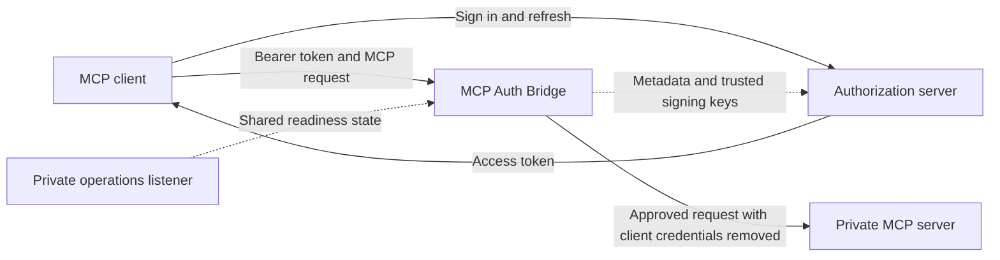

# MCP Auth Bridge documentation

MCP Auth Bridge protects one private HTTP MCP server. It validates access tokens
and permissions before forwarding approved requests, and removes client
credentials at the proxy boundary. Your authorization server owns sign-in and
issues the tokens.

These guides describe the self-hosted Python alpha **0.1.0a2**. The package is
[available on GitHub](https://github.com/anilpervaiz/mcp-auth-bridge/releases/tag/v0.1.0a2)
under Apache-2.0. There is no hosted account service or production availability
guarantee.

## Start here

| Your goal | Read |
|---|---|
| Try a working example without Docker | [Quickstart](quickstart.md) |
| Have a coding agent install and configure it | [Agent setup](agent-setup.md) |
| Protect your own MCP endpoint | [Configuration](configuration.md), then [operations](operations.md) |
| Connect a tested MCP client | [Client setup](client-setup.md) and [compatibility](compatibility.md) |
| Embed the bridge in Python | [Python API](python-api.md) |
| Understand how we tested for bugs | [Testing and release evidence](testing.md) |
| Resolve an error or installation failure | [Troubleshooting](troubleshooting.md) |

The quickest check is the Docker-free demo in the [quickstart](quickstart.md).
It starts an issuer, safe sample tools, and the bridge on your machine; runs real
HTTP requests with the official SDK; and stops its services afterward. It does
not require a paid hosting service or a project API key.

## How the pieces fit

You configure three exact values: the bridge's public resource URL, the token
issuer, and the private upstream URL. The resource URL is the expected token
audience. Login alone is insufficient: the issuer must grant the scopes and mint
an access token for that resource.

The bridge serves protected-resource metadata so compatible clients can discover
the authorization server. It validates each protected request independently,
checks global permissions before reading its body, then checks the MCP method and
applicable name against the body and policy before proxying.

## Choose your path

### Local demonstration

1. Follow [quickstart](quickstart.md) and get a passing HTTP report.
2. For browser sign-in, follow the optional [Keycloak demo](browser-demo.md).
3. Compare your chosen client with the [tested versions](compatibility.md).

The local test issuer and Keycloak realm are disposable examples. Do not reuse
their accounts, keys, or realm settings for a real deployment.

### Your own server

1. Check [limitations](known-limitations.md) and client compatibility.
2. Configure your issuer to mint the required resource-bound access tokens.
3. Follow [configuration](configuration.md) and validate all three trust values.
4. Keep the upstream and operations interface private; read [operations](operations.md).
5. Verify a permitted call, a denied call that never reaches the upstream, and cleanup.

A coding agent can follow [AGENTS.md](../AGENTS.md) and the [agent guide](agent-setup.md).
That does not establish compatibility of the agent's built-in MCP client.

## Deeper references

- [Architecture](architecture.md): request flow, trust fetching, proxy lifecycle.
- [Threat model](threat-model.md): controls, assumptions, and boundaries.
- [Testing](testing.md): repeatable commands, bug scenarios, and dated evidence.
- [Release verification](provenance.md): wheel/source builds, checksums, and attestations.
- [Known limitations](known-limitations.md): unsupported transports, providers, and deployment assumptions.
- [Security reporting](../SECURITY.md), [privacy](../PRIVACY.md), [support](../SUPPORT.md),
  [contributing](../CONTRIBUTING.md), and [changelog](../CHANGELOG.md).

Documentation on `main` may be newer than the package tag. The release manifest
and versioned source establish which implementation was tested and shipped;
[testing evidence](testing.md#released-alpha-evidence) identifies that revision.
